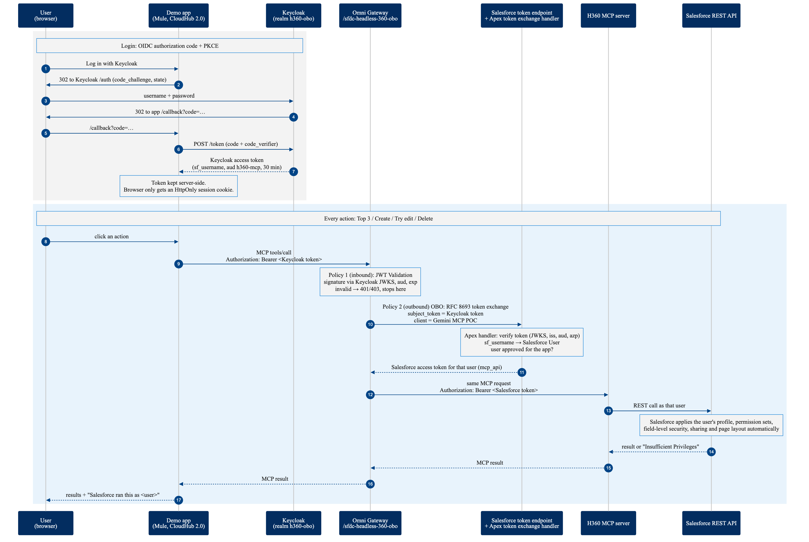
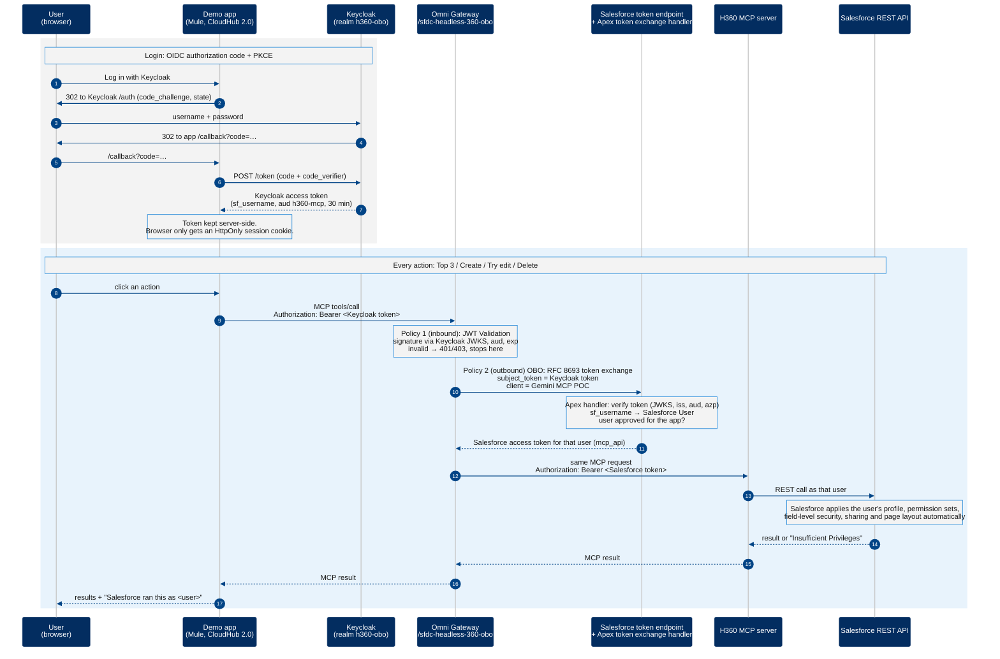
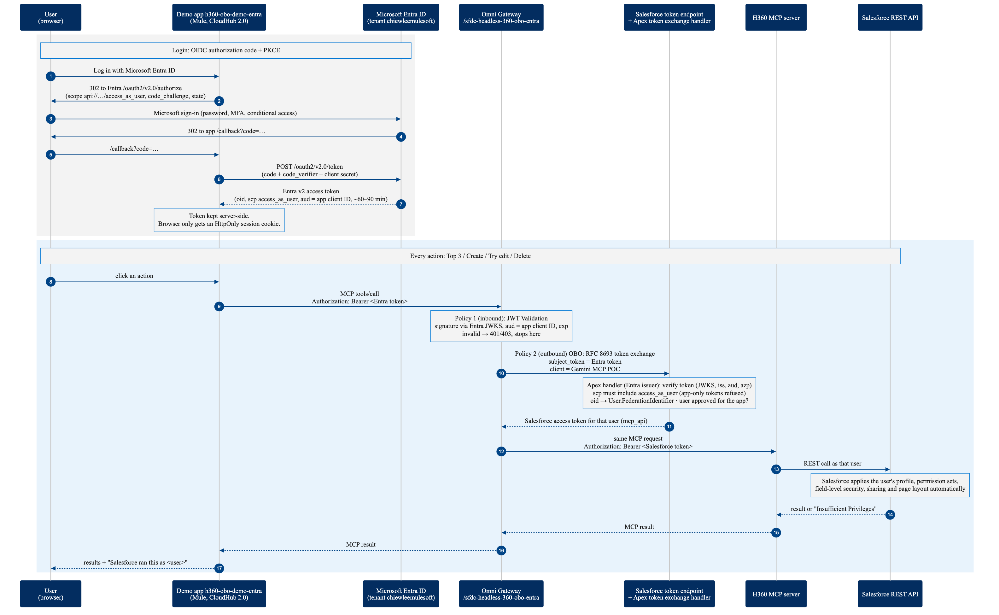

# Salesforce Headless 360 On-Behalf-Of (OBO) with Keycloak and MuleSoft Omni Gateway

How a user who signs in with **Keycloak** gets their own Salesforce identity and permissions
when an app calls the **Salesforce Headless 360 (H360) MCP server**, without the app ever
holding a Salesforce credential.

*Status: working end to end, 2026-10-22. Sandbox / demo setup.*

---

## 1. Why

Agents and integrations usually call Salesforce as one shared integration user. Every action is
then attributed to that account, and every caller gets its (often admin) access.

With OBO, each call runs **as the person who signed in**:

- **Audit:** Created By / Last Modified By show the real user.
- **Least privilege:** Salesforce enforces that user's profile, permission sets, field-level
  security and sharing on every call.
- **No credentials in the app:** the app only holds the user's Keycloak token; the gateway does
  the exchange.

---

## 2. Components

| Component | What it is | Where |
|---|---|---|
| **Keycloak** | Identity provider; users log in here | `https://keycloak-1792182140.web.cloud-services.demos.mulesoft.com`, realm **`h360-obo`** |
| **Demo app** | Mule 4 app: login, page, MCP calls to H360 | CloudHub 2.0 `https://h360-obo-demo-ky9yvn.aqopru.usa-e1.cloudhub.io` (code: `mule-app/`) |
| **Omni Gateway** | Flex Gateway route with the two policies | `https://my-flex-gateway-ky9yvn.aqopru.usa-e1.cloudhub.io/sfdc-headless-360-obo/` (API Manager instance `21251324`, Sandbox) |
| **Salesforce token endpoint** | Does the RFC 8693 token exchange | `https://trailsignup-ef2c09d411b9d5.my.salesforce.com/services/oauth2/token` |
| **Apex token exchange handler** | Validates the Keycloak token, picks the Salesforce user | class `KeycloakOboTokenExchangeHandler` (source: `salesforce/classes/`) |
| **External Client App** | Salesforce app the exchange runs under | **Gemini MCP POC** (`Gemini_MCP_POC`) |
| **H360 MCP server** | Salesforce-hosted MCP server (`discover`, `describe`, `dispatch`, `dispatch_readonly`, `display_widget`) | upstream of the gateway route: `https://api.salesforce.com/platform/mcp/v1/platform/headless-360` |

---

## 3. The flow

Mermaid source (diagrams/h360-obo-sequence.mmd)

### Step by step

1. **Login starts.** The user clicks *Log in with Keycloak*. The app creates a session, a random
   `state` and a PKCE `code_verifier`, and redirects to Keycloak's `/auth` endpoint with the
   SHA-256 `code_challenge`.
2. **The user signs in at Keycloak.** Credentials are only ever typed into Keycloak.
3. **Keycloak returns a one-time code** to the app's `/callback` (allowed redirect URI).
4. **The app swaps the code for tokens** at Keycloak's `/token` endpoint, proving it started the
   login with the `code_verifier` (PKCE; the client is public, no secret).
5. **The token stays in the app.** The Keycloak access token is stored server-side (in-memory
   Object Store); the browser only gets an `HttpOnly` `sid` cookie.
6. **The user clicks an action.** The app opens an MCP session with the gateway (`initialize`,
   `notifications/initialized`) and sends `tools/call`, always with
   `Authorization: Bearer <Keycloak token>`.
7. **Gateway, inbound: JWT Validation.** Checks the token's signature against Keycloak's JWKS,
   the audience `h360-mcp` and the expiry. Invalid tokens stop here (401/403); nothing reaches
   Salesforce.
8. **Gateway, outbound: OAuth 2.0 OBO Credential Injection.** Posts an RFC 8693 token exchange
   to Salesforce: `grant_type=urn:ietf:params:oauth:grant-type:token-exchange`,
   `subject_token=<Keycloak token>`,
   `subject_token_type=urn:ietf:params:oauth:token-type:access_token`, authenticated with
   **Gemini MCP POC**'s client ID and secret.
9. **Salesforce picks the user.** The External Client App's token exchange handler,
   `KeycloakOboTokenExchangeHandler`, validates the token again (JWKS signature and expiry,
   `iss`, `aud`, `azp`) and maps the **`sf_username`** claim to the User with that Username.
   Salesforce checks the user is active and approved for the app, then issues an access token
   **for that user** (scope `mcp_api`).
10. **The gateway swaps the header.** The Authorization header now carries the Salesforce token;
    the request is forwarded to H360.
11. **H360 runs the call as that user** via the Salesforce REST API. Salesforce applies the
    user's permissions automatically (section 5).
12. **The result goes back** through the gateway to the app and the page, including who
    Salesforce ran the call as (`/chatter/users/me`).

### Which token is where

| Token | Issued by | Seen by | Never seen by |
|---|---|---|---|
| Keycloak login code | Keycloak | browser (once), app | gateway, Salesforce |
| Keycloak access token | Keycloak | app, gateway, Apex handler (as `subject_token`) | browser, H360 |
| Salesforce access token (per user) | Salesforce | gateway, H360 | app, browser |
| Gemini MCP POC client secret | Salesforce (app config) | gateway OBO policy | app, browser, Keycloak |

---

## 4. Configuration reference

### 4.1 Keycloak (realm `h360-obo`)

Admin console: `https://keycloak-1792182140.web.cloud-services.demos.mulesoft.com/admin/master/console/#/h360-obo`

| Item | Setting |
|---|---|
| Issuer | `https://keycloak-1792182140.web.cloud-services.demos.mulesoft.com/realms/h360-obo` |
| JWKS | `.../realms/h360-obo/protocol/openid-connect/certs` |
| Access token lifespan | 30 minutes |
| User profile | unmanaged attributes **admin-edit only** (users can't change their own `sf_username`) |
| Client **`h360-mcp-client`** | public, standard flow, **PKCE S256**; direct grant **on** (test scripts only) |
| Redirect URIs | `https://h360-obo-demo-ky9yvn.aqopru.usa-e1.cloudhub.io/callback`, `http://localhost:*`, `http://127.0.0.1:*` |
| Post-logout redirect URIs | `https://h360-obo-demo-ky9yvn.aqopru.usa-e1.cloudhub.io/`, `http://localhost:*`, `http://127.0.0.1:*` |
| Mapper `aud-h360` | audience mapper, adds `h360-mcp` to `aud` |
| Mapper `sf_username` | user attribute `sf_username` into the access and ID tokens |
| Users | `h360-demo-user` → `h360-demo-user.ef2c09d411b9d5@example.com` (H360 Demo User); `chiew-lee` → `trailsignup.ef2c09d411b9d5@salesforce.com` (Chiew Lee) |

Recreate with `scripts/setup-keycloak.sh` (admin helper `scripts/kc.sh`). Passwords live in
`~/.config/keycloak-sandbox-clee/` (owner-only files), not in the repo.

### 4.2 Omni Gateway (API Manager instance `21251324`, path `/sfdc-headless-360-obo`)

Upstream: `https://api.salesforce.com/platform/mcp/v1/platform/headless-360`.

| Order | Policy | Key settings |
|---|---|---|
| 1 (inbound) | **JWT Validation** 0.11.1 | token from bearer header; RSA via JWKS `.../realms/h360-obo/protocol/openid-connect/certs`; validate `aud` = `h360-mcp`; `exp` mandatory; **client ID validation off** |
| 2 (outbound) | **OAuth 2.0 OBO Credential Injection** 1.1.3 | flow `oauth2-token-exchange`; token endpoint `https://trailsignup-ef2c09d411b9d5.my.salesforce.com/services/oauth2/token`; client ID/secret = Gemini MCP POC; subject token type access token; target type `audience` = `https://trailsignup-ef2c09d411b9d5.my.salesforce.com` |

The separate route `/sfdc-headless-360/` (instance `21173896`) has no policies and passes a
Salesforce client-credentials token straight through; Claude Code's `sfdc-headless-360-via-omni-gateway`
MCP server uses it. Don't add JWT Validation there.

### 4.3 Salesforce (org `trailsignup-ef2c09d411b9d5`)

| Item | Setting |
|---|---|
| Apex class | `KeycloakOboTokenExchangeHandler` extends `Auth.Oauth2TokenExchangeHandler`; checks JWKS signature + `exp`, `iss`, `aud` = `h360-mcp`, `azp` = `h360-mcp-client`; returns the User whose Username = `sf_username` |
| Remote site | `Keycloak_H360_OBO` → Keycloak host (for the JWKS callout) |
| Token Exchange Handler | registered with the class above, enabled on Gemini MCP POC (default handler), token type access token |
| External Client App **Gemini MCP POC** | **Token Exchange Flow on**; client credentials flow also on (run-as Chiew Lee, used by other tools); scope includes `mcp_api` |
| Permitted users | **Admin approved users are pre-authorized**, via permission set **`H360 MCP App Access`** (assigned to Chiew Lee and H360 Demo User) |
| Demo user | **H360 Demo User**, profile Standard User, no password (only reachable through the exchange) |
| Opportunity sharing | org-wide default **Public Read Only** |
| Opportunity Layout | Account *mobile card* removed (H360 treated Account as read-only because of it) |

### 4.4 Demo app (Mule)

| Item | Setting |
|---|---|
| Runtime | Mule **4.12.5 Edge**, Java 17, CloudHub 2.0 private space `clee-inc-ps` (Sandbox), 1 replica, 0.1 vCore |
| Config | `src/main/resources/config.yaml`: Keycloak host/realm/client, gateway host/path, demo Account Id |
| Secrets | **none** |
| Routes | `/`, `/login`, `/callback`, `/logout`, `/api/top`, `/api/edit`, `/api/create`, `/api/delete` |

---

## 5. How permissions are applied

The username is used **once**, at step 9, to decide whose token Salesforce issues. After that,
every H360 call is checked by Salesforce's normal security model for that user, automatically:

| Layer | Decides |
|---|---|
| Object permissions (profile, permission sets) | read / create / edit / delete Opportunities at all |
| Field-level security | which fields can be seen or changed |
| System permissions | e.g. *Modify All Data*, *View All Data*, *API Enabled* |
| Sharing (org-wide defaults, ownership, roles, sharing rules) | which records can be seen or changed |
| Page layout (H360 `dispatch`) | required and read-only fields on writes |

Neither the app nor the gateway checks permissions. Exception to keep in mind: custom Apex
running in system mode can bypass sharing; the standard REST calls H360 makes always enforce it.

**Result in the demo**

| Opportunity | Owner | as **H360 Demo User** (Standard User) | as **Chiew Lee** (System Admin) |
|---|---|---|---|
| Q4 Demo Deal ($3M) | Chiew Lee | read ✔, edit ✖ *Insufficient Privileges* | read ✔, edit ✔ |
| OBO Demo - Created via Keycloak ($1M) | H360 Demo User | read ✔, edit ✔ | read ✔, edit ✔ (Modify All) |
| New opportunity | – | create ✔, Created By = H360 Demo User | create ✔, Created By = Chiew Lee |

---

## 6. Demo script

1. Open `https://h360-obo-demo-ky9yvn.aqopru.usa-e1.cloudhub.io` → **Log in with Keycloak** as
   `h360-demo-user`.
2. **Top 3 opportunities**: "Salesforce ran this query as H360 Demo User".
3. **Try edit** on the Q4 Demo Deal → ✖ refused. **Try edit** on the user's own deal → ✔ allowed.
4. **Create opportunity** ($2M) → Created By / Owner = H360 Demo User; it appears in the top 3.
5. **Log out**, log in as `chiew-lee` → same page now runs as Chiew Lee; **Try edit** on the
   Q4 Demo Deal → ✔ allowed.
6. Optional: open the record in Salesforce to show the audit fields. Use **Delete** on the
   user's own rows to reset.

Only the Keycloak login changes between the two runs; app, gateway and H360 calls are identical.

---

## 7. Troubleshooting (errors met while building)

| Symptom | Cause | Fix |
|---|---|---|
| Token exchange `invalid_request: token handler not found` | no handler registered on the app | register the Apex handler and enable it on the External Client App |
| `invalid_grant: user hasn't approved this consumer` | Permitted Users = self-authorize; token exchange has no consent screen | Permitted Users = admin pre-approved + app permission set |
| `invalid_app_access: user is not admin approved` (also breaks client credentials) | user, or the client-credentials run-as user, not in the app's permission set | add the permission set in the External Client App **Policies** UI (the API insert returned 201 but didn't take effect) |
| Gateway 400 `JWT Token is required` | no bearer token | send `Authorization: Bearer <Keycloak token>` |
| Gateway 401 `Invalid token` | not a Keycloak token (bad signature) or expired | log in again |
| Gateway 403 `Authentication denied` | JWT Validation's client ID validation on: Keycloak tokens have no `client_id` claim and no API Manager contract | turn client ID validation off (optionally validate `azp` as a custom claim) |
| Create refused: `CurrencyIsoCode, AccountId, ForecastCategoryName` required | H360 applies page-layout required fields | send them |
| Create refused: `AccountId is read-only in the Lightning UI` | Account also on the layout as a read-only mobile card | remove the mobile card |
| `Value ... for field StageName is not one of the values currently available` | stage not in the user's record type's sales process | use Qualification / Discovery / Proposal/Quote / Negotiation / Closed Won / Closed Lost |
| Keycloak `Invalid redirect uri` on logout | post-logout URIs set to `+`, but the redirect list only had `/callback` | list the post-logout URIs explicitly (`##`-separated) |

---

## 8. Hardening before real use

- **Rotate** the secrets shared during the build: Keycloak admin password, Gemini MCP POC client
  secret, Anypoint Connected App secret.
- **Turn off direct grant** on `h360-mcp-client` (switch `scripts/test-obo.py` to a browser login).
- **Give OBO its own External Client App** with only token exchange on, so the gateway doesn't
  hold a secret that can also mint client-credentials tokens as an admin.
- **Map on a stable identifier** (e.g. User Federation ID from a provisioned value) instead of
  Username, and **refuse privileged users** in the handler.
- **Real users**: provision Keycloak users (or federate Keycloak to your IdP) with `sf_username`
  set by an admin or provisioning process, never by the user.

---

## 9. Files

| Path | What |
|---|---|
| `scripts/setup-keycloak.sh` | creates realm, client, mappers, demo user |
| `scripts/kc.sh` | Keycloak admin REST helper |
| `scripts/test-obo.py` | end-to-end test: direct exchange, or `--via-gateway=<URL>` |
| `salesforce/classes/KeycloakOboTokenExchangeHandler.cls` | Apex handler source |
| `local-local-demo/app.py` | first (Python, local) version of the demo app |
| `mule-app/` | Mule demo app deployed to CloudHub 2.0 |

---

## 10. Entra ID variant

Same flow, with **Microsoft Entra ID** in place of Keycloak. The OBO policy, the Salesforce
token exchange, H360 and Salesforce's permission checks are unchanged.

| Piece | Entra setting |
|---|---|
| Tenant | `e81fdb49-f453-4fb1-acec-589f688c68d6` (issuer `https://login.microsoftonline.com/<tenant>/v2.0`) |
| App registration | **H360 OBO Demo**, client ID `618c685b-60ab-4dd2-a825-147941207fde`; exposes scope `access_as_user`; **v2 tokens**; Web redirect `https://h360-obo-demo-entra-ky9yvn.aqopru.usa-e1.cloudhub.io/callback` (+ `http://localhost:8081/callback`); client secret |
| Demo app | `h360-obo-demo-entra` (same jar, 1.1.0) with `idp.*` Runtime Manager properties; `idp.clientSecret` as a **secured** property |
| Gateway | API instance `21257802`, path `/sfdc-headless-360-obo-entra`: JWT Validation with Entra JWKS (`.../discovery/v2.0/keys`), `aud` = client ID; OBO policy on the upstream |
| Apex handler | picks the IdP by issuer; for Entra requires `scp` = `access_as_user` (app-only tokens refused) and maps **`oid` → User.FederationIdentifier** |
| User mapping | Chiew Lee → `f3628b3b-546e-4755-ba51-2e195e4ad8f0`, H360 Demo User → `6e5aa76d-b14a-4a63-8043-0af9d35d228e` |

Differences from Keycloak worth knowing: Entra needs a client secret (Web platform), its
access tokens last ~60–90 minutes, and a guest account signs in at its home organisation
(MFA / conditional access apply). Mapping on `oid` is stronger than Keycloak's admin-set
`sf_username`, since `oid` can't be changed.
